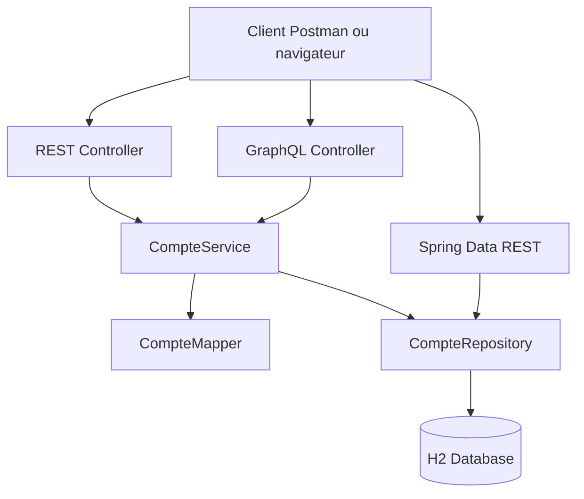

# Compte rendu — Activité Pratique N°1
## Implémentation d'un microservice avec Spring Boot

**Cours :** Systèmes Distribués et DevOps (2026–2027) — II-BDCC3  
**Professeur :** Mohamed YOUSSFI  
**Étudiant :** Elghouali Zakariae  
**Date :** à compléter lors de l'exécution

### 1. Objectif

Reproduire les étapes du sujet Google Classroom : construire un microservice bancaire Spring Boot, vérifier la couche DAO, proposer une API REST avec Postman/Swagger, employer Spring Data REST et ses projections, séparer les modèles par des DTO et mappers, développer une couche service, et fournir une API GraphQL.

### 2. Environnement et dépendances

- Java 21, Spring Boot 3.4.5, Maven.
- Spring Web, Data JPA, H2, Lombok, Validation.
- Springdoc OpenAPI 2.8.5 (Swagger UI).
- Spring Data REST et projections.
- Spring for GraphQL.
- Postman pour les appels REST.

### 3. Déroulement des 11 étapes

#### Étape 1 — Initialisation du projet
Dépendances configurées dans `pom.xml`. Base H2 en mémoire, port HTTP 8081, paramètres dans `application.yml`.
**Capture 1 :** projet importé dans IntelliJ et dépendances Maven chargées — _à insérer_.

#### Étape 2 — Entité JPA Compte
L'entité `Compte` contient un identifiant généré, la date de création, le solde `BigDecimal`, le type `COURANT/EPARGNE`, la devise et un numéro de version JPA.
**Capture 2 :** classe `Compte` et table `COMPTES` dans la console H2 — _à insérer_.

#### Étape 3 — Repository Spring Data
`CompteRepository` étend `JpaRepository<Compte,Long>` et expose une méthode `findByTypeCompte`.
**Capture 3 :** repository — _à insérer_.

#### Étape 4 — Tests DAO
`CompteRepositoryTest` crée un compte, vérifie sa clé primaire, teste `findById` et la recherche par type.
**Résultat effectif :** _à renseigner après exécution Maven/JUnit_.
**Capture 4 :** résultat du test JUnit — _à insérer_.

#### Étape 5 — Web service RESTful
`CompteRestController` propose GET/POST/PUT/DELETE des comptes ainsi que le dépôt et le retrait. Le service lève des exceptions métier lors d'un découvert.
**Capture 5 :** liste JSON de `/api/comptes` — _à insérer_.

#### Étape 6 — Postman
Import de `postman/TP1_Comptes.postman_collection.json` et exécution du scénario 1000 + 500 − 200 = 1300 MAD.
**Résultat effectif :** _à renseigner après exécution_.
**Capture 6 :** création, dépôt et retrait Postman — _à insérer_.

#### Étape 7 — Documentation Swagger
OpenAPI généré par Springdoc : `http://localhost:8081/swagger-ui.html`. API JSON `/v3/api-docs`.
**Capture 7 :** Swagger UI avec les méthodes REST — _à insérer_.

#### Étape 8 — Spring Data REST / projections
`CompteRepository` exporté à `/data-rest/comptes`. `?projection=resume` limite la réponse à `id`, `solde`, `typeCompte`. `?projection=detail` donne des détails supplémentaires.
**Capture 8 :** réponse Spring Data REST avec projection — _à insérer_.

#### Étape 9 — DTO et Mapper
`CompteRequest`, `CompteResponse`, `MontantRequest` isolent les entrées/sorties REST. `CompteMapper` effectue la conversion entre `Compte` et DTO.
**Capture 9 :** DTO et Mapper dans IntelliJ — _à insérer_.

#### Étape 10 — Couche Service
`CompteService` et `CompteServiceImpl` définissent les opérations métier transactionnelles (créer, modifier, déposer, retirer, supprimer), avec validation des retraits. H2 est la base pédagogique, pas une base bancaire de production.
**Capture 10 :** service et exécution des tests — _à insérer_.

#### Étape 11 — Web service GraphQL
Le schéma `src/main/resources/graphql/schema.graphqls` définit les queries `allComptes`, `compteById` et les mutations `createCompte`, `updateCompte`, `deposer`, `retirer`, `deleteCompte`. Un contrôleur GraphQL délègue au service.
**Capture 11 :** exécution d'une query et mutation GraphiQL — _à insérer_.

### 4. Architecture

### 5. Tableau de validation

| Test | Résultat attendu | Résultat observé |
|---|---|---|
| DAO save / find | Compte enregistré puis retrouvé | Non exécuté |
| POST création | 201 et identifiant | Non exécuté |
| Dépôt 500 (solde 1000) | Solde 1500 | Non exécuté |
| Retrait 200 | Solde 1300 | Non exécuté |
| Retrait 900000 | HTTP 409 | Non exécuté |
| Swagger UI | Contrats REST visibles | Non exécuté |
| Projection `resume` | Champs restreints | Non exécuté |
| GraphQL query/mutation | Données cohérentes | Non exécuté |

### 6. Limites et conclusion

Le TP explique l'articulation des couches HTTP, métier et persistance et montre plusieurs manières d'exposer un même domaine (REST classique, Spring Data REST, GraphQL). L'exécution complète ne pouvait pas être confirmée dans l'environnement de génération (Maven et dépendances indisponibles). Ajouter les vraies captures et observations avant la remise.

### Références du professeur

- https://www.youtube.com/watch?v=2-qloZcvhAw
- https://www.youtube.com/watch?v=FsdRO9jlqaE
